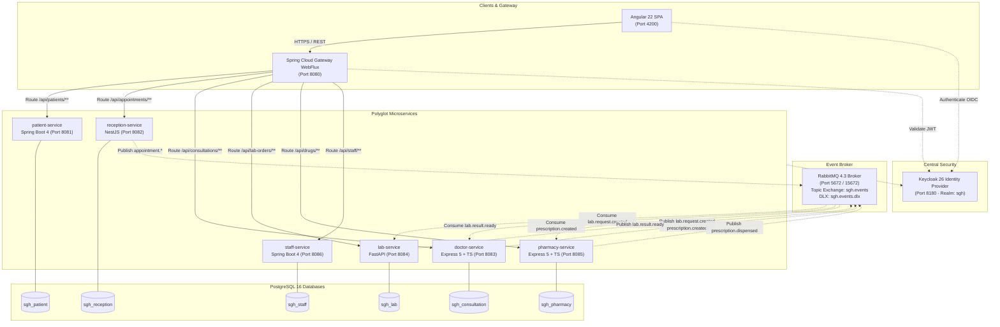

# SGH — Hospital Management System (Système de Gestion Hospitalière)

[-blue.svg)](#)
[](#)
[-orange.svg)](#)
[-red.svg)](#)
[-informational.svg)](#)

A distributed, enterprise-grade hospital management system designed and built for the **Applications Web Distribuées** course at **ESPRIT**. The platform demonstrates production patterns for polyglot microservices, event-driven architecture, resilient inter-service communication, centralized identity & access management, and modern frontend clinical workflows.

---

## Table of Contents

1. [System Overview & Clinical Workflow](#1-system-overview--clinical-workflow)
2. [High-Level Architecture](#2-high-level-architecture)
3. [Microservices Catalogue](#3-microservices-catalogue)
4. [Event-Driven Architecture (RabbitMQ)](#4-event-driven-architecture-rabbitmq)
5. [Resilience & Distributed Systems Principles (X-1 to X-9)](#5-resilience--distributed-systems-principles-x-1-to-x-9)
6. [Identity & Access Management (Keycloak)](#6-identity--access-management-keycloak)
7. [Repository Layout & Conventions](#7-repository-layout--conventions)
8. [Prerequisites & Development Environment](#8-prerequisites--development-environment)
9. [Quickstart Guide](#9-quickstart-guide)
10. [Testing & Verification](#10-testing--verification)
11. [Git Workflow & Definition of Done](#11-git-workflow--definition-of-done)

---

## 1. System Overview & Clinical Workflow

SGH orchestrates the full patient care lifecycle across specialized clinical and administrative hospital departments:

```
[Patient Admission / Appointment] ──> [Consultation & SOAP Notes] ──┬──> [Prescriptions Issued] ──> [Pharmacy Dispensing & Stock]
      (Reception Service)                  (Doctor Service)          │          (Doctor)                     (Pharmacy Service)
                                                                     │
                                                                     └──> [Lab Orders Created] ───> [Lab Execution & Results]
                                                                                (Doctor)                     (Lab Service)
```

1. **Patient & Reception**: Patients are admitted, registered with unique identifiers, and scheduled for appointments. Invoices and reminders are generated automatically.
2. **Clinical Consultation**: Doctors record structured clinical data (SOAP: Subjective, Objective, Assessment, Plan) and nurses measure vital signs. 
3. **Prescriptions**: Doctors prescribe medications linked to consultations. Prescriptions are published asynchronously over RabbitMQ to the pharmacy queue.
4. **Laboratory Workflow**: Doctors order lab panels (routine or urgent). The lab service consumes orders, technicians record measurements, compute reference flags (`NORMAL`, `HIGH`, `LOW`, `CRITICAL`), and validate results, which sync back to the consultation record.
5. **Pharmacy & Inventory**: Pharmacists review electronic prescriptions, manage inventory with real-time stock deductions, and dispense medications with atomic stock tracking.
6. **Staff & Access Control**: Central directory for hospital practitioners, nursing staff, technicians, and administrative roles.

---

## Implementation status

| Part | Status |
|---|---|
| `contracts/` (6 OpenAPI files, event schemas) | Done |
| `infra/` (Postgres, RabbitMQ topology, Keycloak realm) | Done |
| `frontend/` Angular app | Built against the mock servers; real Keycloak sign-in is a placeholder (`pending-keycloak.backend.ts`) |
| `services/doctor-service` | Implemented and tested |
| `services/patient-service`, `reception-service`, `lab-service`, `pharmacy-service`, `staff-service` | Not started (folder holds the README and rules only) |
| `gateway/` | Not started |
| End-to-end and resilience scripts | `scripts/e2e.sh` and `scripts/stub-check.sh` not written yet |

Until the remaining services exist, run the front end with `npm run mock` / `npm run start:mock` (see `tools/mock/README.md`).

---

## 2. High-Level Architecture

The system strictly follows the **Database-per-Service** pattern, centralized OAuth2/OIDC security, and asynchronous message broker decoupling:



---

## 3. Microservices Catalogue

| Microservice | Folder | Port | Stack & Framework | Database | Key Responsibilities |
|---|---|---|---|---|---|
| **Patient Service** | `services/patient-service` | `8081` | Spring Boot 4, JDK 17, JPA, Flyway | `sgh_patient` | Patient master index, demographics, medical file notes, patient search. |
| **Reception Service** | `services/reception-service` | `8082` | NestJS 12, TypeORM, `@nestjs/schedule` | `sgh_reception` | Appointment scheduling, slot availability, check-in, billing, invoices. |
| **Doctor Service** | `services/doctor-service` | `8083` | Express 5, TypeScript, `pg`, Zod, Pino | `sgh_consultation` | SOAP consultations, signing/locking, vital signs, prescriptions, lab orders. |
| **Lab Service** | `services/lab-service` | `8084` | FastAPI, Python 3.12, SQLAlchemy, Alembic | `sgh_lab` | Test catalogue, sample processing, automated flag computation, result validation. |
| **Pharmacy Service** | `services/pharmacy-service` | `8085` | Express 5, TypeScript, `pg`, Zod, Pino | `sgh_pharmacy` | Drug catalog, inventory levels, low-stock alerts, atomic dispensing. |
| **Staff Service** | `services/staff-service` | `8086` | Spring Boot 4, JDK 17, JPA, Flyway | `sgh_staff` | Staff directory, practitioner licensing, roles, department assignment. |
| **API Gateway** | `gateway` | `8080` | Spring Cloud Gateway WebFlux | *None* | Central ingress, reverse proxy, JWT token relay, CORS, correlation ID injection. |
| **Frontend** | `frontend` | `4200` | Angular 22, Zoneless, Angular Material | *None* | Responsive clinical workstation, doctor/nurse/patient/admin dashboards. |

---

## 4. Event-Driven Architecture (RabbitMQ)

Services interact asynchronously using **RabbitMQ 4** via the topic exchange `sgh.events`. Message delivery is non-blocking, durable, and idempotent.

### Event Catalogue

| Event Type | Routing Key | Publisher | Consumer Queues | Description |
|---|---|---|---|---|
| `appointment.created` | `appointment.created` | Reception | *Notification / Stretch* | Triggered when a patient schedules an appointment. |
| `appointment.cancelled` | `appointment.cancelled` | Reception | *Notification / Stretch* | Triggered when an appointment is cancelled. |
| `lab.request.created` | `lab.request.created` | Doctor | `lab.lab.request.created` | Emitted when a doctor orders diagnostic laboratory panels. |
| `lab.result.ready` | `lab.result.ready` | Lab | `consultation.lab.result.ready` | Emitted when a lab technician validates test results. |
| `prescription.created` | `prescription.created` | Doctor | `pharmacy.prescription.created` | Emitted when a doctor issues a prescription. |
| `prescription.dispensed` | `prescription.dispensed` | Pharmacy | *Audit / Stretch* | Emitted when a pharmacist dispenses medications. |

### Message Envelope Schema (`envelope.schema.json`)
Every message wrapped in a standardized envelope:
```json
{
  "eventId": "3fa85f64-5717-4562-b3fc-2c963f66afa6",
  "type": "lab.request.created",
  "version": 1,
  "occurredAt": "2026-10-12T09:30:00Z",
  "correlationId": "b3f1c2d4-e5f6-7a8b-9c0d-1e2f3a4b5c6d",
  "data": { ... }
}
```

* **Dead-Letter Exchange (DLX)**: `sgh.events.dlx` (fanout) captures unprocessable or rejected messages into `sgh.events.dlq`.
* **Idempotency (Rule X-5)**: Every consumer maintains a local `processed_events (event_id, event_type, processed_at)` table inside the transaction boundary. Duplicate messages are acknowledged and safely ignored.

---

## 5. Resilience & Distributed Systems Principles (X-1 to X-9)

The system adheres to 9 strict architectural resilience rules defined in the specification:

1. **Independent Boot (X-6 / X-8)**: A microservice must start even if PostgreSQL, RabbitMQ, or peer services are offline.
   - `GET /health` returns `200 {"status":"UP"}` immediately upon process launch.
   - Endpoints requiring the database return `503 Service Unavailable` with body `{"error":"Service Unavailable","message":"Database unavailable"}` until background migrations and connection loops succeed.
2. **Synchronous Call Resilience (Rule X-2)**:
   - Direct service-to-service calls have a hard **2.0-second timeout**.
   - Context propagation: Forward incoming `Authorization` Bearer token and `X-Correlation-Id`.
   - **Documented Fallbacks**:
     - *Doctor → Patient (`GET /api/patients/:id/summary`)*: If Patient service fails, times out, or returns 5xx, the consultation is still created with `patientSnapshot = null` (Rule CON-2).
     - *Reception → Patient (`GET /api/patients/:id/summary`)*: If down, appointment is created with `patientVerified = false`.
     - *Pharmacy → Doctor (`GET /api/consultations/:id/prescriptions`)*: If down, falls back to the locally cached prescription copy.
3. **Asynchronous Publishing**: Events are published in background tasks *after* the local database transaction commits. If RabbitMQ is temporarily down, exponential retry is executed without blocking or failing the HTTP response.
4. **Structured Error Format**: All APIs return consistent RFC 7807-compliant JSON error bodies:
   ```json
   {
     "timestamp": "2026-10-12T09:30:00Z",
     "status": 422,
     "error": "Unprocessable Entity",
     "message": "Validation failed",
     "path": "/api/consultations",
     "correlationId": "b3f1c2d4",
     "details": [{ "field": "assessment", "problem": "must not be blank" }]
   }
   ```

---

## 6. Identity & Access Management (Keycloak)

Authentication and role-based access control (RBAC) are centralized using **Keycloak 26**.

* **Realm**: `sgh`
* **Token Issuer**: `http://localhost:8180/realms/sgh`
* **JWKS Endpoint**: `http://localhost:8180/realms/sgh/protocol/openid-connect/certs`
* **Role Extraction**: `realm_access.roles` (strictly evaluated before payload validation).
* **Identity Claims**: Tokens include `staffId` (for clinical staff) and `patientId` (for patients) mapped as top-level claims.

### Pre-Configured Test Accounts (Dev Password: `Sgh@dev2026`)

| Username | Role | Associated Entity ID | Description |
|---|---|---|---|
| `doctor1` | `DOCTOR` | `staffId: b2b2b2b2-0000-4000-8000-000000000001` | Amel Trabelsi (Cardiology) |
| `doctor2` | `DOCTOR` | `staffId: b2b2b2b2-0000-4000-8000-000000000002` | Karim Jlassi (General practice) |
| `nurse1` | `NURSE` | `staffId: b2b2b2b2-0000-4000-8000-000000000003` | Sonia Gharbi (Triage & vital signs) |
| `lab1` | `LAB_TECHNICIAN` | `staffId: b2b2b2b2-0000-4000-8000-000000000004` | Walid Mansouri (Laboratory) |
| `pharmacist1` | `PHARMACIST` | `staffId: b2b2b2b2-0000-4000-8000-000000000005` | Ines Chaabane (Pharmacy) |
| `reception1` | `RECEPTIONIST` | `staffId: b2b2b2b2-0000-4000-8000-000000000006` | Rim Bouazizi (Front desk) |
| `admin1` | `ADMIN` | `staffId: b2b2b2b2-0000-4000-8000-000000000007` | Sami Hamdi (IT) |
| `patient1` | `PATIENT` | `patientId: a1a1a1a1-0000-4000-8000-000000000001` | Youssef Ben Salah (restricted to own records) |

---

## 7. Repository Layout & Conventions

```
.
├── contracts/                     # Single source of truth (D24)
│   ├── openapi/*.yaml             # 6 OpenAPI 3.1 specifications
│   └── events/*.json              # Message envelope and event payload JSON schemas
├── infra/                         # Shared Docker infrastructure
│   ├── docker-compose.yml         # Postgres 16, RabbitMQ 4, Keycloak 26
│   ├── postgres/init.sql          # Creates the 6 microservice databases
│   ├── rabbitmq/                  # Topology definitions (exchanges, queues, bindings)
│   └── keycloak/sgh-realm.json    # Realm configuration with clients and users
├── gateway/                       # Spring Cloud Gateway WebFlux (Port 8080)
├── frontend/                      # Angular 22 Zoneless SPA (Port 4200)
├── services/                      # Microservices source code
│   ├── patient-service/           # Module 1 (Spring Boot - Port 8081)
│   ├── reception-service/         # Module 2 (NestJS - Port 8082)
│   ├── doctor-service/            # Module 3 (Express TS - Port 8083)
│   ├── lab-service/               # Module 4 (FastAPI - Port 8084)
│   ├── pharmacy-service/          # Module 5 (Express TS - Port 8085)
│   └── staff-service/             # Module 6 (Spring Boot - Port 8086)
├── scripts/                       # Developer utility scripts
│   ├── reset.sh                   # Wipes and restarts all Docker infra cleanly
│   ├── token.sh                   # Obtains a real JWT token from Keycloak for any user
│   ├── health.sh                  # Checks health across all services
│   └── check-contracts.sh         # Verifies byte-identical copy of contracts
└── docs/                          # Architecture blueprints, decisions log, prompt logs
```

### API Standards
* **Pagination**: Standard query parameters `?page=0&size=20` (max 100). Responses format: `{ content: [...], page: 0, size: 20, totalElements: 1, totalPages: 1 }`.
* **Sub-collections**: Plain JSON arrays are used for sub-resources (e.g. `/api/consultations/:id/prescriptions`, `/api/staff/directory`).
* **Traceability**: All requests, responses, and events must propagate `X-Correlation-Id`.

---

## 8. Prerequisites & Development Environment

Ensure the following tools are installed on your workstation:

* **Operating System**: Linux (Ubuntu, Arch/EndeavourOS, Debian), macOS, or Windows 11 with WSL2.
* **Container Engine**: Docker Desktop or Docker Engine ≥ 26.0 with Docker Compose v2.
* **Node.js**: Node.js ≥ 22.22.3 or ≥ 24.15.0 (`node -v`) and `npm` ≥ 10.
* **Java**: OpenJDK 17 or higher (`java -version`).
* **Python**: Python ≥ 3.12 (`python3 --version`).
* **CLI Utilities**: `curl`, `jq` (≥ 1.7), `git`.

---

## 9. Quickstart Guide

### 1. Start Infrastructure (Postgres, RabbitMQ, Keycloak)
```bash
# Start Docker containers in detached mode
docker compose -f infra/docker-compose.yml up -d

# Verify all containers are healthy
docker compose -f infra/docker-compose.yml ps
```
The infrastructure exposes:
* **PostgreSQL 16**: `localhost:5432` (`sgh` / `sgh_dev_password`)
* **RabbitMQ Management**: `http://localhost:15672` (`sgh` / `sgh_dev_password`)
* **Keycloak Admin**: `http://localhost:8180` (`admin` / `admin`)

### 2. Verify Infrastructure & Obtain a Test Token
```bash
# Check connectivity and health
./scripts/health.sh

# Generate a JWT for doctor1 (Amel Trabelsi)
./scripts/token.sh doctor1
```

### 3. Run a Microservice (Example: `doctor-service`)
```bash
cd services/doctor-service

# Install dependencies
npm install

# Run Vitest test suite
npm test

# Build and start the service
npm run build
npm start
```
The doctor service runs on `http://localhost:8083`:
* Health check: `http://localhost:8083/health`
* Swagger UI Docs: `http://localhost:8083/docs`
* OpenAPI JSON: `http://localhost:8083/openapi.json`

### 4. Run the Angular Frontend
```bash
cd frontend

# Install frontend dependencies
npm install

# Run tests
npm test

# Start Angular development server
npm start
```
Open your browser at `http://localhost:4200`.

---

## 10. Testing & Verification

Each service includes standalone unit and integration suites that test domain rules, authentication gates, and resilience fallbacks:

```bash
# Verify contracts are byte-identical across services
./scripts/check-contracts.sh

# Run the Doctor Service suite (needs Postgres; Keycloak is simulated, RabbitMQ tests are skipped if no broker)
cd services/doctor-service && npm run typecheck && npm test

# Run Frontend unit test suite (266 tests)
cd frontend && npm test
```

---

## 11. Git Workflow & Definition of Done

This project strictly adheres to the course collaboration rules:

1. **One Task, One Branch, One PR**: Direct pushes or merges into `main` are strictly forbidden.
2. **Branching Scheme**:
   * Modules: `<module>-service` (e.g. `doctor-service`, `patient-service`)
   * Shared / Features: `feature/<area>-<topic>` (e.g. `feature/infra`, `feature/gateway`)
3. **Commit Conventions**: Conventional commit format with area prefix:
   * `doctor: implement consultation SOAP note signing`
   * `infra: configure rabbitmq vhosts and dead-letter exchanges`
4. **Definition of Done for a Service**:
   * [x] OpenAPI specification in `openapi.yaml` matches `contracts/openapi/` byte-for-byte.
   * [x] Every endpoint, role restriction, and status code implemented per contract.
   * [x] Asynchronous event publisher and consumer with idempotency (`processed_events`).
   * [x] 100% passing automated test suite covering success, validation, and error paths.
   * [x] Resilience verified: Starts up cleanly even if DB or Broker is down (Rule X-6/X-8).
   * [ ] `scripts/stub-check.sh` stub acceptance list passes (script not written yet).
