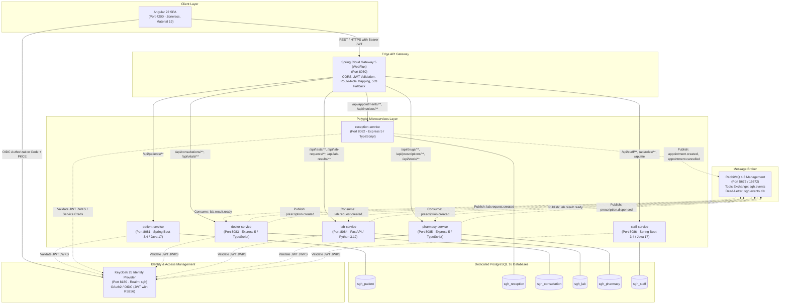

# SGH Architecture Documentation

## 1. System Topology Diagram

The SGH platform is an enterprise-grade distributed hospital management system architected using polyglot microservices, database-per-service isolation, asynchronous message broker decoupling, and centralized OAuth2/OIDC identity management.

---

## 2. Port and Protocol Assignments

| Component | Port | Technology | Protocol | Database |
|-----------|------|------------|----------|----------|
| **frontend** | 4200 | Angular 22 (Zoneless, Material) | HTTP | N/A |
| **gateway** | 8080 | Spring Cloud Gateway 5 (WebFlux) | HTTP | N/A |
| **patient-service** | 8081 | Spring Boot 3.4 / JPA / Flyway | HTTP / REST | `sgh_patient` |
| **reception-service** | 8082 | Node.js / Express 5 / TypeScript | HTTP / REST | `sgh_reception` |
| **doctor-service** | 8083 | Node.js / Express 5 / TypeScript | HTTP / REST | `sgh_consultation` |
| **lab-service** | 8084 | Python 3.12 / FastAPI / SQLAlchemy | HTTP / REST | `sgh_lab` |
| **pharmacy-service** | 8085 | Node.js / Express 5 / TypeScript | HTTP / REST | `sgh_pharmacy` |
| **staff-service** | 8086 | Spring Boot 3.4 / JPA / Flyway | HTTP / REST | `sgh_staff` |
| **Keycloak IAM** | 8180 | Keycloak 26.8.1 (Quarkus) | HTTP / OIDC | Keycloak internal |
| **PostgreSQL** | 5432 | PostgreSQL 16.15 | TCP / SQL | 6 databases |
| **RabbitMQ** | 5672 / 15672 | RabbitMQ 4.3.6 (Topic Exchange) | AMQP 0-9-1 / HTTP | N/A |

---

## 3. Security Architecture (Keycloak OAuth2 / OIDC)

1. **Token Flow**:
   - The Angular single-page application authenticates directly with Keycloak using Authorization Code Flow with PKCE (SHA-256).
   - Keycloak returns a cryptographically signed RS256 JWT containing user identity and assigned hospital roles under `realm_access.roles`.
   - Access tokens are transmitted in the standard HTTP `Authorization: Bearer <JWT>` header through the Gateway and to each microservice.
2. **Standard Roles**:
   The hospital security policy recognizes seven distinct roles:
   - `ADMIN`: Hospital administration and staff directory management
   - `DOCTOR`: Clinical notes, consultations, prescriptions, and lab test orders
   - `NURSE`: Patient vital signs measurement and clinical triage
   - `LAB_TECHNICIAN`: Laboratory test processing, measurement entry, and results validation
   - `PHARMACIST`: Drug catalog management, stock adjustments, and prescription dispensing
   - `RECEPTIONIST`: Patient registration, appointment scheduling, and invoice billing
   - `PATIENT`: Patient self-service portal (own appointments, invoices, and consultations)
3. **Defense-in-Depth Authorization**:
   - **Gateway Level**: Coarse-grained routing authorization checks (e.g., rejecting unauthorized roles immediately with 403 before forwarding).
   - **Service Level**: Fine-grained ownership and role checks executed before JSON body validation (e.g. PAT-4, CON-1). Tokens with altered payloads or invalid signatures (`alg: none`) are rejected with 401.

---

## 4. Messaging & Event-Driven Architecture (RabbitMQ)

- **Topic Exchange**: `sgh.events` (durable, topic).
- **Dead-Letter Exchange**: `sgh.events.dlx` routing to `sgh.events.dlq`.
- **Pre-Declared Queues**:
  - `lab.lab.request.created` bound to `lab.request.created`
  - `pharmacy.prescription.created` bound to `prescription.created`
  - `consultation.lab.result.ready` bound to `lab.result.ready`
- **Guarantees**:
  - **Idempotence**: Every event consumer checks its local `processed_events` table before applying changes.
  - **Post-Commit Publishing**: Outgoing events are dispatched to RabbitMQ only after the local database transaction commits successfully.
  - **Resilient Retry**: In-memory retry loop prevents message loss during transient broker disconnects.

---

## 5. Resilience Principles (X-1 to X-9)

1. **Independent Process Lifecycles (X-1, X-8)**:
   Every microservice starts successfully even if PostgreSQL, RabbitMQ, or peer services are down. Database connections retry in the background with exponential backoff.
2. **Structured Service Status & Fallbacks (X-2, X-3)**:
   Endpoints dependent on a disconnected database return `503 Database unavailable`. The gateway returns structured `503` payloads naming the unavailable target service.
3. **Correlation Tracking (X-7)**:
   Every request generates or forwards `X-Correlation-Id`. All logs, HTTP responses, inter-service HTTP calls, and RabbitMQ event envelopes carry this identifier.
4. **Local Data Redundancy (X-4, X-5)**:
   - Doctor service caches patient demographic snapshots on consultation records.
   - Pharmacy service caches prescription details locally from events, permitting dispensing even during consultation service outages.
